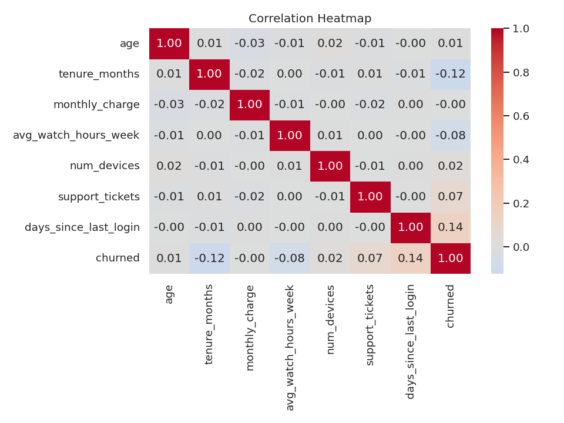
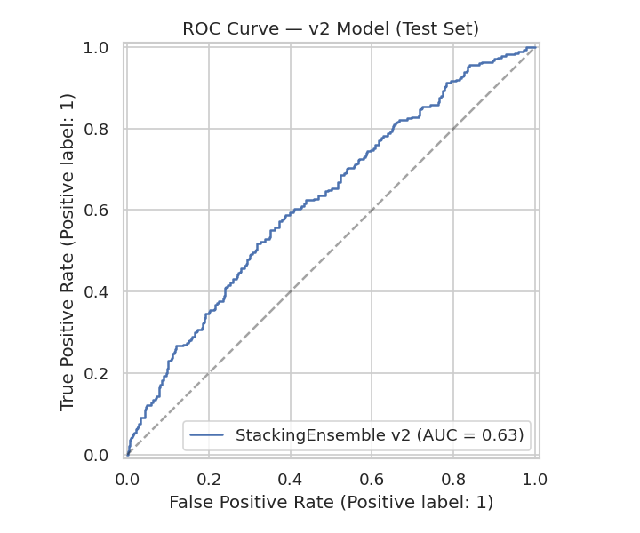
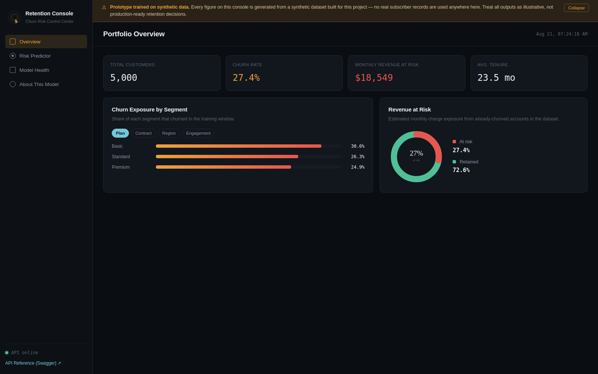
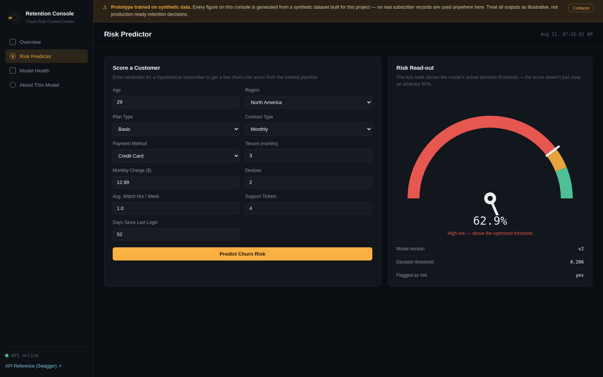
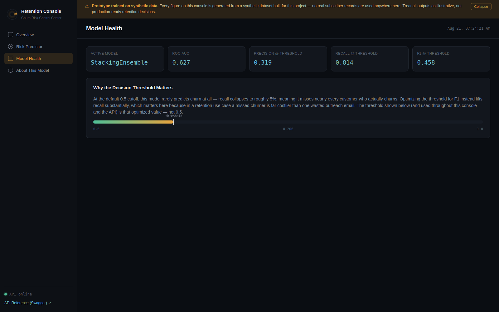
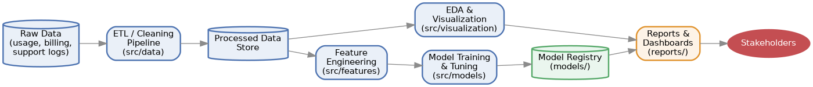

<!--
  Replace <github-username>/<repo-name> below once this is pushed to GitHub
  so the CI badge points at your actual Actions run.
-->
[](https://github.com/shettyprateek045-glitch/Yava/actions/workflows/ci.yml)


# Streaming Service Churn Prediction — Retention Console

Predicting which subscribers are about to cancel, and turning that score into a control center a retention team can actually act on.

## Problem Statement

Subscription businesses lose recurring revenue every time a customer cancels, and by the time someone calls to cancel, it's too late to save them. Most of the warning signs — dropping engagement, support friction, contract type, tenure — are sitting in the account data long before that call happens. The problem this project solves: **given a subscriber's account attributes, estimate how likely they are to churn, early enough that a human can still do something about it.**

## Objective & Business Impact

**In plain terms:** predict customers who are likely to churn, and help a retention team prioritize outreach toward the accounts most likely to leave — instead of contacting everyone, or no one, or only the customers who complain the loudest.

Even an imperfect model is useful here, because the cost is asymmetric: a missed churner is a lost subscriber, while a false alarm is one unnecessary retention email. That asymmetry is why this project optimizes its decision threshold for **recall** rather than overall accuracy (see [Results & Metrics](#results--metrics)) — it would rather flag some customers who were never going to leave than miss the ones who were.

## Key Objectives

- Generate a realistic, reproducible synthetic subscriber dataset (no real customer data used anywhere).
- Explore and visualize the drivers of churn (Week 2).
- Engineer features and train/tune a churn-classification model, with an honest comparison between a baseline and an improved version (Week 3).
- Translate model output into business-facing insight: revenue at risk, segment-level exposure, an executive report (Week 4).
- Package the whole thing behind a real API and a live control-center UI, not just notebooks and static charts (Advanced version).

## Screenshots

| EDA — Feature Correlation | Model Results — ROC Curve (v2) |
| --- | --- |
|  |  |

| Retention Console — Portfolio Overview |
| --- |
|  |

| Retention Console — Risk Predictor | Retention Console — Model Health |
| --- | --- |
|  |  |

All five are real captures of this repository's own output and running app — the KPI numbers, ROC curve, and predicted risk score are exactly what the code produces, not mockups. The one screen not pictured here is `/docs` (Swagger) — the sandbox this was built in blocks the CDN Swagger UI loads its assets from, so that one didn't render; it's a one-click check once you run the API yourself (`uvicorn api:app` → open `/docs`).

## Advanced Platform Features

The project provides an operationalized Retention Intelligence Platform:

- **Parameter Drivers & Explainable AI (XAI):** Real-time breakdown of churn risk drivers per subscriber (`days_since_last_login`, `contract_type`, `support_tickets`, `tenure_months`, `avg_watch_hours_week`) with prescriptive recommendations and Customer Lifetime Value (CLV) at risk.
- **What-If Counterfactual Simulation Engine (`POST /simulate`):** Interactive sandbox allowing retention teams to test interventions (annual contract switch, inactivity drop, ticket resolution, engagement boost) and calculate delta risk reduction and protected ARR.
- **Financial Retention ROI Matrix (`POST /retention/roi`):** Simulates retention campaign economics with configurable outreach costs, target cohorts, conversion rates, and ARR saved to calculate Net Profit and ROI multipliers.
- **Dual-Model Comparison Engine (`POST /predict/compare`):** Evaluates subscribers across baseline v1 (Logistic Regression) and v2 (Stacking Ensemble) simultaneously with divergence analysis.
- **Feature Distribution Drift Monitoring (`GET /monitoring/drift`):** Tracks live prediction distributions against baseline training statistics to detect data drift.
- **Batch CSV Scoring (`POST /predict/csv`):** Secure multi-subscriber CSV upload with instant risk scoring, cohort summary cards, and tabular display.
- **SQLite Governance & Audit Trail (`GET /predictions/history`):** Complete audit trail storing all live customer predictions with timestamps and inputs in SQLite (`data/predictions.db`).

## Tech Stack

Python • Pandas • NumPy • Matplotlib • Seaborn • Scikit-learn • Plotly (via CDN, for the interactive dashboard) • FastAPI • Streamlit • Pytest • Docker • GitHub Actions

## Repository Structure

```text
├── Week1_Project_Planning/       # Dataset generation + project scaffold + diagrams
├── Week2_EDA_Visualization/      # Exploratory data analysis + charts
├── Week3_ML_Model_Development/   # Model training (v1 + v2), metrics, serving_api.py, tests/
├── Week4_Report_Presentation/    # Executive report, static + interactive dashboards
├── app.py                        # Streamlit live demo
├── api.py                        # Control Center product API (advanced backend)
├── static/index.html             # Retention Console frontend (served by api.py)
├── tests/test_api.py             # API-level test suite
├── assets/screenshots/           # Screenshots used in this README
├── MODEL_CARD.md                 # Honest model documentation (intended use, limitations)
├── ADVANCED_VERSION.md           # Full audit + recommended next-stage build-out
├── Dockerfile / docker-compose.yml
└── requirements.txt / requirements-advanced.txt
```

Each week's folder has its own `README.md` with that week's scripts and outputs in detail.

## Architecture



Conceptually: raw usage/billing/support data → cleaning → a processed store → feature engineering → model training/tuning → a model registry (the saved `.joblib` files) → reports and dashboards → the retention team. In this repository, each week's folder plays one of those roles (Week 1 = raw data + ETL, Week 3 = feature engineering + model training + registry, Week 4 = reports/dashboards), and `api.py` + `static/` is the "Reports & Dashboards → Stakeholders" edge made interactive.

## Project Workflow

1. **Week 1 — Planning & Data.** Generates the synthetic dataset every later step reads from, with a fixed random seed for reproducibility, plus the project's architecture/methodology diagrams.
2. **Week 2 — EDA.** Cleans that data and explores it visually — univariate, bivariate, and multivariate — to understand what actually correlates with churn before modeling anything.
3. **Week 3 — Modeling.** Engineers features and trains/evaluates a churn classifier: a v1 baseline (Logistic Regression) and a v2 improved version (richer features + a stacking ensemble + threshold optimization), with permutation importance and calibration analysis.
4. **Week 4 — Communication.** Synthesizes the EDA findings and model results into an executive-ready report, a static dashboard, and a genuinely interactive Plotly dashboard.
5. **Advanced version.** Wraps v2 behind a FastAPI backend and a single-page "Retention Console" so the model is something you can click through, not just read about.

## Results & Metrics

| | v1 — Logistic Regression | v2 — Stacking Ensemble (default 0.5) | v2 — Stacking Ensemble (optimized threshold 0.206) |
| --- | --- | --- | --- |
| ROC-AUC | 0.630 | 0.627 | *(same — threshold-independent)* |
| Accuracy | 0.592 | 0.727 | 0.472 |
| Precision | 0.355 | 0.519 | 0.319 |
| Recall | 0.599 | 0.051 | **0.814** |
| F1 | 0.446 | 0.093 | 0.458 |

**What this means for the business, not just the model:** at the default 50% cutoff, the v2 ensemble looks accurate (72.7%) but is nearly useless for retention — it misses 95% of customers who actually churn, because it's simply reluctant to ever predict "churn." Optimizing the decision threshold instead (down to 0.206) flips that: the model now catches **81% of actual churners**, at the cost of a lot of false alarms (precision drops to 32%). For a retention team, that's the right trade — reviewing an inflated candidate list costs staff time, but missing a real churner costs the subscription outright. Permutation importance also confirms the signal is where you'd expect it to be: **contract type, tenure, and days since last login** are consistently the strongest predictors, which lines up with real-world subscription behavior (month-to-month, newer, disengaged customers are the flight risks).

The takeaway from v1 → v2 is **not** a big accuracy jump — this synthetic dataset has a deliberate noise ceiling around 0.63–0.66 ROC-AUC — it's that *threshold tuning*, not a fancier algorithm, is what makes the model operationally useful. Full honest before/after detail is in [`MODEL_CARD.md`](MODEL_CARD.md).

## How to Run

**Requirements:** Python 3.11+

```bash
# 1. Clone and install
git clone https://github.com/shettyprateek045-glitch/Yava.git
cd Yava
pip install -r requirements.txt -r requirements-advanced.txt

# 2. Reproduce the full four-week pipeline (dataset → EDA → model → report)
python run_all.py

# 3. Run the advanced product: API + Retention Console UI in one process
uvicorn api:app --reload --port 8000
#   open http://127.0.0.1:8000/       -> Retention Console
#   open http://127.0.0.1:8000/docs   -> Swagger API docs

# 4. Or run the simpler Streamlit live demo instead
streamlit run app.py

# 5. Run the test suite (33/33 tests passing)
python -m unittest discover -s Week3_ML_Model_Development/tests -v   # model pipeline (12 tests)
pytest tests/test_api.py -v                                          # API layer & endpoints (21 tests)

# 6. Or run everything in Docker
docker build -t churn-console .
docker run -p 8000:8000 churn-console
```

## Project Limitations

- **Synthetic data only.** Every number in this repository — EDA, metrics, dashboards — comes from a synthetic dataset generated for this project (`Week1_Project_Planning/generate_dataset.py`). Nothing here has been validated against real subscriber behavior.
- **Modest, intentional ROC-AUC ceiling (~0.63–0.66).** The synthetic data was generated with a realistic amount of noise, so this is expected, not a tuning failure — but it means the model's ranking is meaningfully better than random, not near-perfect.
- **No temporal validation.** Everything here is a single train/test split on data generated at one point in time; a production system needs validation on data that evolves over time.
- **The demo API is unauthenticated and uses permissive CORS (`*`)** — appropriate for a local portfolio demo, not for a real deployment.
- **Demo authentication:** The API uses permissive CORS (`*`) and runs unauthenticated — appropriate for a local portfolio demo, requiring API keys or OAuth before enterprise deployment. (Persistence is handled via SQLite audit logging, and feature drift is tracked via `/monitoring/drift`).

## Future Enhancements

The top priorities toward a production-style build (the full list, with rationale for each, is in [`ADVANCED_VERSION.md`](ADVANCED_VERSION.md)):

1. **Real customer data** — replace the synthetic dataset with real, consented subscriber data and re-validate everything against it.
2. **A database + prediction history** — persist every score with a timestamp, instead of the current stateless request/response.
3. **Authentication** — API keys or OAuth in front of the prediction endpoints before any real deployment.
4. **Model drift & calibration monitoring** — track live scoring-time feature distributions and calibration against the training distribution over time.
5. **Cloud deployment** — take the existing `Dockerfile` the rest of the way to a real hosted environment (with tightened CORS and proper secrets management).

## License

[MIT](LICENSE) — see the `LICENSE` file for the full text.
